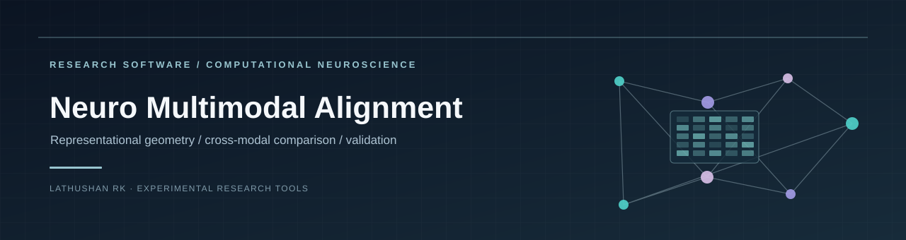
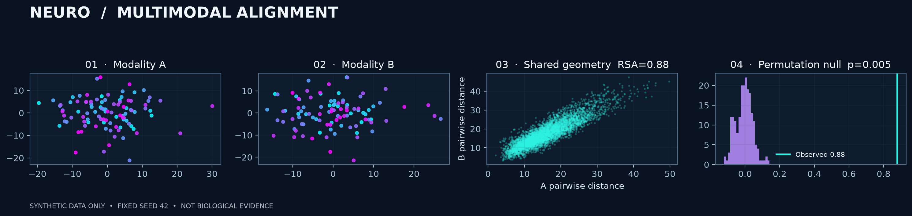
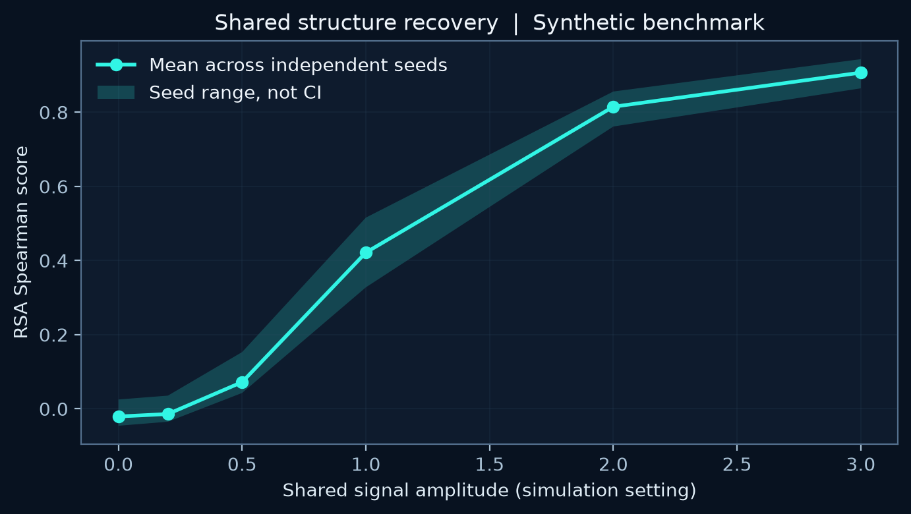
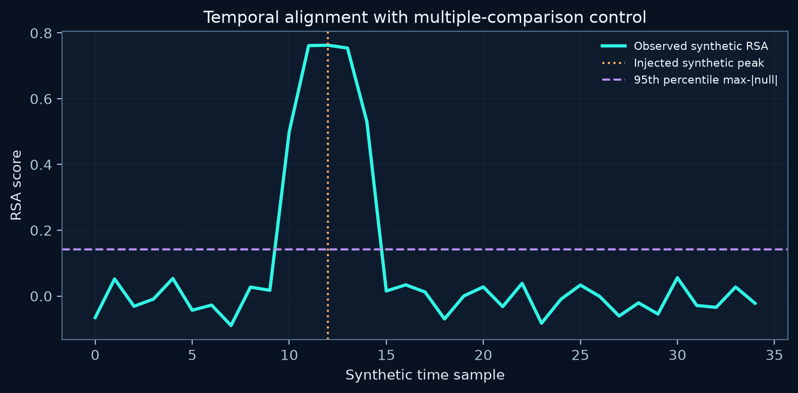

<p align="center">
  
</p>

<h1 align="center">Neuro Multimodal Alignment</h1>

<p align="center"><strong>Python methods for comparing the structure of paired neural representations.</strong></p>

<p align="center"><sub>Research software · v0.5.0 · Python 3.10+ · MIT License</sub></p>

<p align="center">[Research question](#research-question) · [Methods](#analysis-methods) · [Try an example](#start-with-a-synthetic-experiment) · [Figures](#what-the-simulations-test) · [Limits](#real-data-example-current-status)</p>

---

## Research question

EEG, MEG and fMRI offer different measurements of brain activity. Even where an experiment presents the same stimuli or compares the same conditions, the recorded signals have different spatial and temporal characteristics. Directly comparing their raw sensor values is often not meaningful.

This package examines a narrower question: **do two sets of measurements preserve similar relationships among the experimental items they represent?** It provides several ways to measure correspondence between feature matrices, along with checks intended to reduce spurious alignment and overfitting.

The analyses require a defensible relationship between observations in the two datasets. Matching row counts are not enough.



*Illustration from a synthetic benchmark, not participant EEG, MEG or fMRI recordings.*

## Analysis methods

**Representational similarity analysis (RSA).** Construct a dissimilarity matrix within each dataset, then compare the upper triangles of the matrices using Spearman correlation. RSA summarizes the geometry of relationships among observations; the basic score is descriptive.

**Canonical correlation analysis (CCA).** Learn linear combinations of features that covary across datasets. Scaling and optional dimension reduction are fitted on training data, and the canonical correlations are evaluated on held-out observations. High training correlation alone can be misleading.

**Orthogonal Procrustes.** Fit a rotation or reflection that maps one coordinate representation toward another, then examine alignment error on held-out observations. Geometric agreement is not biological equivalence.

**Shared and modality-specific structure.** Estimate cross-modal predictability with a defined linear model. The results depend on that model and should not be interpreted as the uniquely measurable biological amount of shared information.

**Temporal RSA.** Compare representational geometry across time samples, with permutation-based controls. Temporal peaks are measures of alignment under a chosen comparison, not proof of neural transmission or causal timing.

The [method notes](docs/index.md) explain prerequisites, common failure modes, and interpretation.

## Start with a synthetic experiment

From the root of the cloned repository:

```bash
python -m pip install -e ".[dev]"
python -m pytest -q
python examples/01_ground_truth_simulation.py
```

The example constructs feature matrices with known shared factors and noise. It then computes an RSA score and a permutation-based comparison.

```python
from nma.simulation import generate_shared_private
from nma.rsa import rsa_score
from nma.statistics import rsa_permutation_test

sim = generate_shared_private(
    n_samples=160,
    shared_strength=2.5,
    noise=0.1,
    random_state=42,
)
score = rsa_score(sim.aligned, metric="euclidean")
test = rsa_permutation_test(
    sim.aligned,
    metric="euclidean",
    n_permutations=199,
    random_state=42,
)

print("Synthetic RSA:", score)
print("Permutation p-value:", test.pvalue)
```

The outcome is specific to this seeded simulation. It does not establish correspondence between recordings from real participants.

For a Windows environment, [getting started](docs/getting_started.md) includes Python installation and virtual-environment instructions.

## What the simulations test

The repository includes four figures, generated by [`reproduce/make_figures.py`](reproduce/make_figures.py):

| Figure | Question examined |
| --- | --- |
| [Shared structure](assets/shared_structure.png) | How does measured cross-modal correspondence change when a controlled shared factor is varied? |
| [CCA and overfitting](assets/cca_leakage.png) | How different can training and held-out correlations be in high-dimensional data? |
| [Temporal alignment](assets/temporal_alignment.png) | Can the analysis recover an injected temporal relationship under a specified null model? |
| [Overview](assets/hero_synthetic.png) | How do two synthetic feature sets compare in representational geometry and against a permutation reference? |

All four are **synthetic demonstrations**; the results are produced by code, not claimed to be measurements from a participant. Recreate them with:

```bash
python reproduce/make_figures.py
```


### Selected synthetic demonstrations

| Controlled shared structure | Temporal correspondence under a specified model |
| --- | --- |
|  |  |

*Both figures are generated from synthetic data. They do not show participant recordings or demonstrate biological correspondence across modalities.*

## Pairing observations is essential

The analysis starts with two feature matrices, usually called `X` and `Y`. Their rows must refer to corresponding observations according to an explicitly declared pairing design. The toolkit supports observation-level, subject-level or condition-level matching and checks identifiers and metadata. It cannot independently establish whether the supplied identifiers are scientifically correct.

Cross-validation needs the same care: if several observations belong to one participant or session, a trial-level random split may give misleading performance. Relevant routines support group-aware evaluation, but the researcher must define the groups and decide whether the resulting inference is appropriate.

Read [data alignment](docs/data_alignment.md) and [statistical assumptions](docs/statistics.md) before using the package for a study.

## Real-data example: current status

An [optional MNE EEG/MEG example](examples/04_mne_eeg_meg_demo.py) is provided as a starting point for public sample recordings. The packaged release does **not** report completed empirical results from that example; execution against downloaded recordings remains unverified.

The toolkit is not an EEG-to-fMRI converter, a clinical classifier or evidence that different measurement modalities encode identical neural processes.

## Software validation

The v0.5.0 validation record reports 49 local tests, 93% statement coverage, three executed synthetic examples and three executed synthetic notebooks. The [GitHub Actions history](https://github.com/lathushanrk-cmd/neuro-multimodal-alignment/actions) provides the actual hosted results for package builds, lint and cross-platform tests. The [validation report](VALIDATION_REPORT.md) distinguishes software checks from biological evidence.

Known-answer simulations test whether the methods behave as expected under specified conditions. They cannot establish general validity for arbitrary neuroscience datasets. In particular, the validity of permutations depends on exchangeability, and temporal correspondence can be influenced by modality-specific sampling and hemodynamic responses. Further discussion is in [limitations](docs/limitations.md).

For the reasoning behind the analysis design, see [implementation notes](docs/implementation_notes.md). The [demonstration walkthrough](docs/walkthrough.md) provides a short reproducible explanation of the core methods.

## Files and documentation

| Path | Contents |
| --- | --- |
| [`src/nma/`](src/nma/) | Analysis implementation |
| [`tests/`](tests/) | Numerical, scientific-safeguard and error-condition tests |
| [`examples/`](examples/) | Executable scripts and notebooks |
| [`reproduce/`](reproduce/) | Synthetic figures and benchmarks |
| [`docs/`](docs/) | Method descriptions and data requirements |
| [`assets/`](assets/) | Generated PNG and SVG figures |

## Development note

The research concept, scientific methods, testing, and documentation were developed by Lathushan RK. AI-assisted tools supported programming, troubleshooting, and improvements to the software implementation.

## Author

**Lathushan RK** — Independent researcher  
Research interests: computational neuroscience, neural dynamics, brain-state representation, neurophysiology and multimodal neural measurements.

The software is available under the [MIT License](LICENSE). See [`CITATION.cff`](CITATION.cff) for citation information and [`CONTRIBUTING.md`](CONTRIBUTING.md) for contributions. Version 0.5.0 is an early research release; no DOI, peer-reviewed scientific finding, or independent biological validation is claimed.
