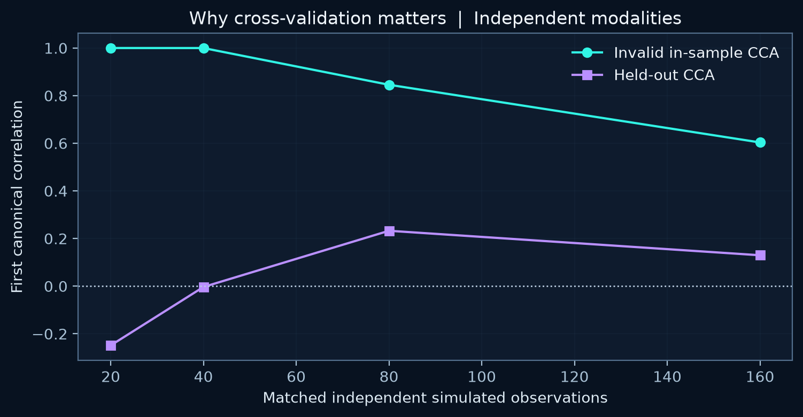

<div align="center">


# NEURO MULTIMODAL ALIGNMENT

### A Reproducible Toolkit for Comparing Shared Neural Representations Across Measurement Modalities

**Python research toolkit · RSA · Cross-validated CCA · Procrustes · Temporal alignment**

   

</div>

## The big idea

Brain measurements can describe the same experiment in very different ways. EEG and MEG record rapid electrical or magnetic signals. fMRI tracks slower blood-oxygen-related changes. **How can we tell whether different measurements preserve similar relationships among stimuli or brain states?**

Neuro Multimodal Alignment helps researchers test those relationships **without pretending that different signals are identical**. It focuses on careful matching of observations, controlled statistical comparisons, and transparent validation.

> **Current status:** Installable research software prototype (`v0.5.0`). Figures below come from synthetic simulations, not participant recordings. No DOI, independent biological validation, or publication is claimed.

## Why comparing modalities matters

EEG and MEG capture fast electrical and magnetic fields, while fMRI measures slower blood-oxygen-related changes. Their raw values, units and timings are very different. The purpose here is to compare **relationships among explicitly matched experimental items**, not to claim that two signals are biologically identical.

## What it can do

| Method | Plain-English meaning | Main caution |
|---|---|---|
| **RSA** | Compare whether two modalities show similar patterns of relationships among the same experimental units | A similar pattern is not the same biological mechanism |
| **CCA** | Find linear combinations of features that correlate across modalities | Report correlations on held-out data, not training data |
| **Procrustes** | Find the best rotation/reflection to align two reduced representations | A small error does not prove biological identity |
| **Temporal RSA** | Explore when representational similarity appears across a time series | A peak is not automatically a biological lag |
| **Permutation tests** | Compare an observed score against correspondence-broken data | Only shuffle units that are exchangeable |
| **Ground-truth simulation** | Create known shared, private and noise factors to test the methods | Simulated success is not real-data validation |

## How the workflow fits together

```text
Modality A features   +   Modality B features
            |             |
            +--- Match observations by ID ---+
                         |
                 Fit transformations
                   TRAIN DATA ONLY
                         |
             RSA / CCA / Procrustes
                         |
              Held-out evaluation
                         |
           Permutation / uncertainty checks
                         |
             Reproducible visualizations
```

**Important:** paired observations, condition-paired summaries and unpaired datasets are different experimental situations. This toolkit requires a justified correspondence between rows. It does not silently assume two unrelated datasets are paired.

## See the simulated experiments

### Shared structure across synthetic modalities


The generator creates truly shared latent factors plus separate modality-private factors and noise. This plot shows a simulation parameter sweep, **not a biological effect**. The shaded area is a seed range, not a confidence interval.

### Temporal similarity and permutation controls


The injected synthetic signal provides a known peak. Max-statistic permutations assess peaks across the displayed time points under the synthetic exchangeability assumptions.

### Why training correlations can mislead



Independent synthetic feature matrices may show spuriously impressive training CCA correlations. A held-out estimate provides a better assessment of generalization.

## Install and try it

Requires Python 3.10 or newer. Open the repository in a terminal or Windows PowerShell.

```bash
python -m pip install -e ".[dev]"
python -m pytest -q
python examples/01_ground_truth_simulation.py
```

Run a short Python example:

```python
from nma.simulation import generate_shared_private
from nma.rsa import rsa_score
from nma.statistics import rsa_permutation_test

simulation = generate_shared_private(n_samples=100, random_state=42)
aligned = simulation.aligned

score = rsa_score(aligned, metric="euclidean")
result = rsa_permutation_test(aligned, metric="euclidean", n_permutations=199)
print("Synthetic RSA:", round(score, 3))
print("Permutation p-value:", result.pvalue)
```

See [complete Windows/Linux steps](docs/getting_started.md). The public `nma` API is summarized in [API documentation](docs/api.md).

## Make the scientific figures yourself

```bash
python reproduce/make_figures.py
```

Every numerical image is regenerated from source code. PNG files appear in the GitHub README and SVG versions provide vector-quality graphics. **No data or outcome was manually invented.**

## Understanding the results

**RSA:** A descriptive Spearman comparison of which experimental items appear similar or different across modalities. It is **not automatically cross-validated RSA**.

**CCA:** Correlations between learned combinations of features on held-out observations. High in-sample correlations can reflect overfitting, especially with too many features.

**Procrustes:** The held-out difference after the best training-derived rotation/reflection of low-dimensional representations. Small error is not biological identity.

**Temporal RSA:** The time-dependent correspondence of representational relationships; the optional `blocks` argument restricts null permutations to declared exchangeable groups. An alignment peak is not a measured neural transmission delay.

**Shared versus private:** Linear cross-modal predictability is a model-dependent estimate, not a direct measurement of unique biological shared information.

## Use your own neuroscience features

Create matrices `X` and `Y` where rows are **the same known experimental units** in the same order. Provide unique IDs and declare `pairing="observation"`, `"condition"`, or `"subject"`. The toolkit also offers an ID-aware reordering constructor. The researcher must verify that supplied IDs really refer to matching observations; the program cannot establish this biological truth. If data have no defensible correspondence, direct paired alignment is not justified.

Optional [MNE EEG+MEG demonstration](docs/open_data.md) uses sample data acquired outside this ZIP. It has **not** been run against downloaded real recordings in the packaged validation and is not presented as empirical evidence.

## Validation status

The revised source passes **49 local tests**; three synthetic Python examples and three synthetic Jupyter notebooks executed, and four PNG plus four SVG scientific figures regenerated successfully. These are local software checks, **not independent biological validation**. The real MNE sample EEG+MEG recording was not downloaded or analyzed. GitHub-hosted package builds and a cross-platform test matrix have passed on published code. A clean installation on an independent Windows laptop has not been verified. See [validation report](VALIDATION_REPORT.md).

## Repository map

| Folder | What you will find |
|---|---|
| `src/nma/` | Installable Python analysis package |
| `tests/` | Known-answer and failure-condition checks |
| `examples/` | Small runnable synthetic examples and optional MNE adapter |
| `reproduce/` | Exact code generating every scientific graphic |
| `assets/` | Actual generated PNG and SVG images |
| `docs/` | Beginner explanations, scientific methods and original master guide |
| `.github/workflows/` | Definitions for Windows/Linux testing and package builds |

## Scientific transparency

- Scaling, optional PCA and CCA are fitted on the **training fold only**.
- RSA summarizes relational geometry and does not infer identical neural activity.
- Permutation logic depends on exchangeability and sampling design.
- Cross-modal prediction describes model-based predictability, not biologically unique information.
- Temporal alignment does not by itself measure neural transmission delays or hemodynamic causality.
- **Unit-test success does not constitute independent biological validation.**

Run [local benchmarks](docs/performance.md). Read the [validation report](VALIDATION_REPORT.md), [statistical assumptions](docs/statistics.md), and [full limitations](docs/limitations.md).

## Author

**Lathushan RK**  
Department of Life Sciences, NSBM Green University, Sri Lanka  
Biomedical Science undergraduate with research interests in computational neuroscience, neurophysiology, neural dynamics and multimodal measurement.

## Citation, contributions and license

Software metadata: [`CITATION.cff`](CITATION.cff). Please cite the repository version used. See the scientific limitations and validation record above. Released under the [MIT License](LICENSE). See [CONTRIBUTING.md](CONTRIBUTING.md) for how to contribute and [CHANGELOG.md](CHANGELOG.md) for release notes.
